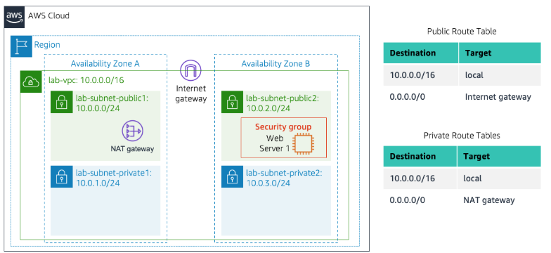

# AWS VPC and EC2 web-server lab

I built a custom VPC with public and private subnets across two Availability Zones, configured their routing, and launched an EC2 web server in the second public subnet. The saved browser capture shows the application responding over HTTP, and the lab grading screenshot records **30/30**.

## Lab architecture

[Full detailed report](report.pdf) · [All 24 original images](assets/)

## Network plan

| Resource | Recorded configuration |
| --- | --- |
| VPC | `lab-vpc`, `10.0.0.0/16` |
| First AZ | Public `10.0.0.0/24`; private `10.0.1.0/24` |
| Second AZ | Public `10.0.2.0/24`; private `10.0.3.0/24` |
| Public default route | `0.0.0.0/0` to the Internet Gateway |
| Private default route | `0.0.0.0/0` to the NAT Gateway |
| Web server | Amazon Linux 2023, `t2.micro`, public2, public IPv4 enabled |
| HTTP ingress | TCP 80 from `0.0.0.0/0` |

## Work and results

- Created the VPC, gateways, initial subnets and route tables.
- Added the second public/private subnet pair and configured associations.
- Investigated why a standard AWS `/24` has 251 nominally assignable addresses.
- Created the web security group and configured the instance user-data script.
- Observed Web Server 1 progress from initializing to **2/2 checks passed**.
- Opened the public DNS using HTTP and saw the training application.
- Captured **5/5 for each of six grading checks**, totaling **30/30**.

The detailed report uses both working notes, includes all 24 original images unchanged, and explains CIDR sizing, local/default routes, NAT versus Internet Gateway paths, the security group, bootstrap commands, HTTP validation and the grading result.

The captures span multiple training sessions. The report distinguishes transitional configurations from final results and documents the remaining gaps, including the same-instance outbound-rule/bootstrap record and an independent private-subnet NAT traffic test. The two-AZ subnet layout is not presented as a fully redundant application deployment.

References: [VPC subnet sizing](https://docs.aws.amazon.com/vpc/latest/userguide/subnet-sizing.html), [Internet gateways](https://docs.aws.amazon.com/vpc/latest/userguide/VPC_Internet_Gateway.html), [NAT gateways](https://docs.aws.amazon.com/vpc/latest/userguide/vpc-nat-gateway.html).
